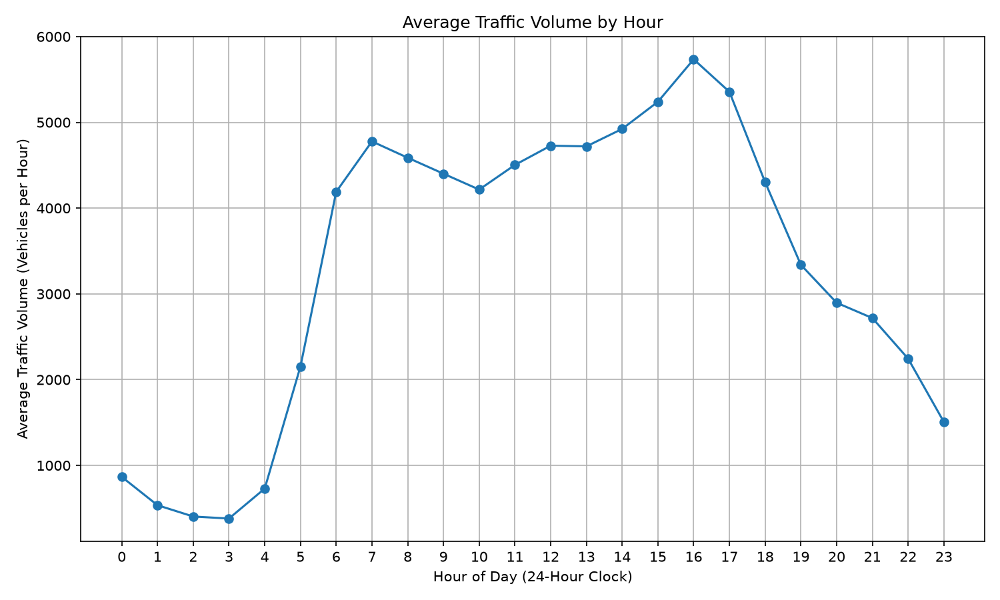
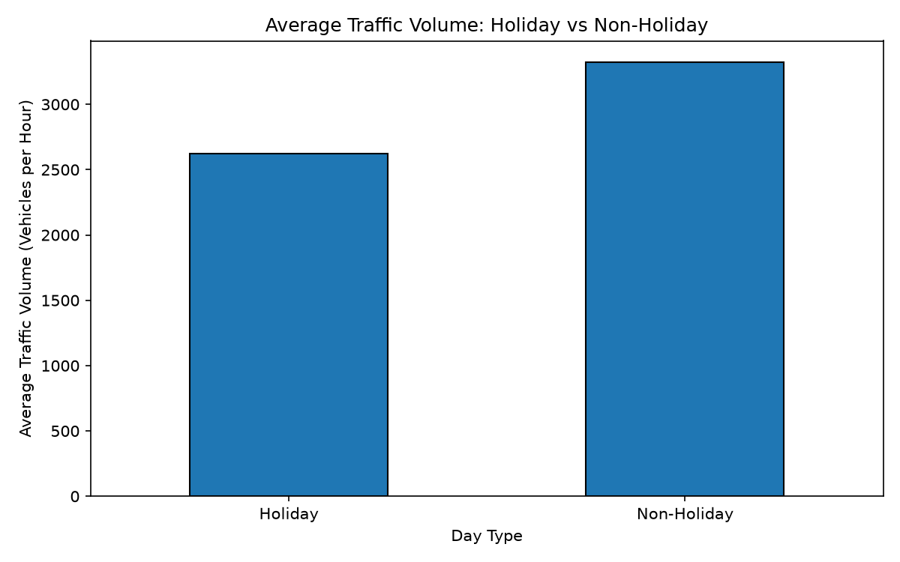
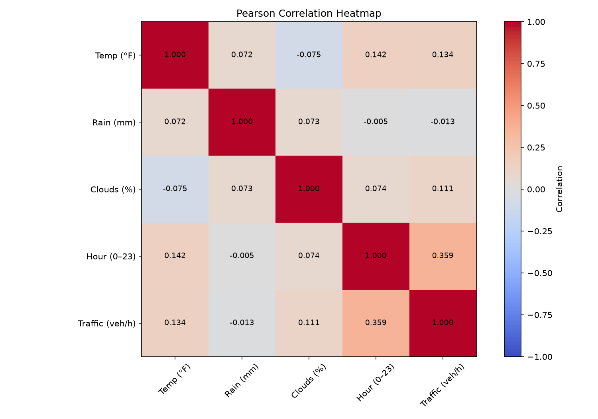
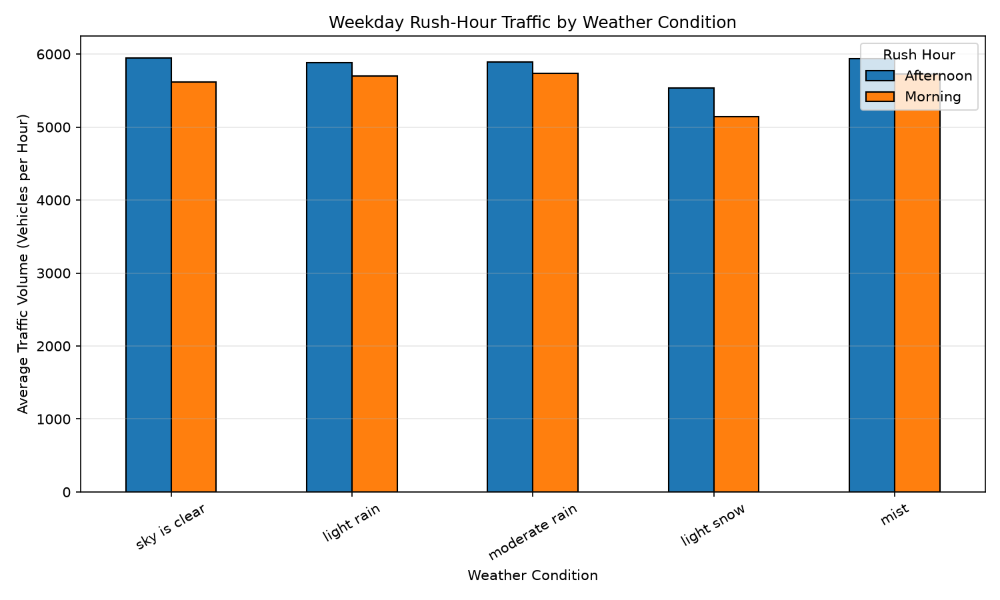
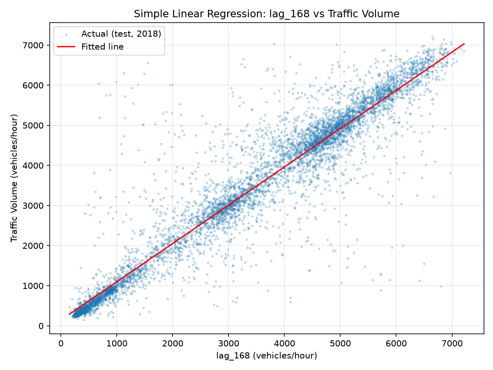

# Traffic Volume Prediction
 
Predicting hourly westbound I-94 traffic volume Minneapolis to St. Paul from time, weather, and holiday data using simple linear regression.
 
## Key Results
 
- **Best model:** simple linear regression on lag_168.
  traffic_volume = 144.6 + 0.955 × lag_168, with MAE: 355, RMSE: 641, R²: 0.894 on 2018 test data.
- **Weather doesn't matter on its own:** temp, rain, and cloud cover each explain 2% of the variation or less.
- **Weekends and holidays are quieter:** Weekend hours average 877 fewer vehicles and holiday hours 601 fewer.
## Dataset
[Metro Interstate Traffic Volume](https://archive.ics.uci.edu/dataset/492/metro+interstate+traffic+volume): 48,204 hourly records (2012–2018) of traffic volume with weather and holiday features.
 
John Hogue, 2019, *Metro Interstate Traffic Volume* [Dataset], UCI Machine Learning Repository, DOI 10.24432/C5X60B. Licensed under CC BY 4.0.
 
### Variables used
 
| Variable | Description |
|---|---|
| `traffic_volume` (**target**) | Hourly westbound I-94 traffic volume |
| `date_time` | Hour of the reading |
| `temp` / `temp_f` | Temperature in Kelvin / Fahrenheit |
| `rain_1h` | Rain in mm for the hour |
| `clouds_all` | Cloud cover in percent |
| `holiday` | US holiday name |
| `weather_description` | Text description of the weather |
 
`snow_1h` was dropped during cleaning
 
 
## Exploratory Analysis
 
Descriptive statistics, correlations, and charts are in `notebooks/statistical_analysis_finaljup.ipynb`.
 
**Traffic follows a strong daily cycle.** Volume is lowest around 3 AM (under 400 vehicles/hour on average), rises sharply from 5 AM, and peaks around 4 PM (about 5,700 on average).
 

 
**Weekdays are much busier than weekends,** especially at rush hour: about 6,050 vs 1,630 vehicles at 7 AM. Holiday hours average 2,623 vehicles vs 3,320 on non-holidays.
 

 
**Weather has weak linear relationships with traffic.** Correlations with traffic volume are 0.13 for temperature, 0.11 for cloud cover, and -0.01 for rain. Hour of day has the strongest correlation (0.36), and even that understates its effect, because the daily pattern is a curve, not a straight line.
 

 
**Weekday rush-hour traffic drops in light snow** (about 5,140 vs 5,620 vehicles in the morning rush compared with clear skies), while light and moderate rain show little difference.
 

 
 
### Features
 
| Feature | Description |
|---|---|
| `hour`, `dayofweek`, `month` | Time of reading |
| `is_weekend`, `is_holiday` | 1/0 flags |
| `temp_f`, `rain_1h`, `clouds_all` | Weather |
| `weather_group` | weather descriptions grouped into categories |
| `lag_1`, `lag_24`, `lag_168` | Traffic 1 hour, 24 hours, and 1 week (168 hours) earlier |
| `rolling_24` | Average traffic over the previous 24 hours |
 

 
## Results
 
Test set (Jan–Sep 2018), sorted by RMSE:
 
| Model | MAE | RMSE | R² | Intercept | Slope |
|---|---:|---:|---:|---:|---:|
| Simple LR (`lag_168`) | 355 | 641 | 0.894 | 144.6 | 0.955 |
| Naive baseline (`lag_168`) | 339 | 649 | 0.891 | 0 | 1 |
| Simple LR (`lag_1`) | 599 | 798 | 0.836 | 283.9 | 0.914 |
| Simple LR (`lag_24`) | 626 | 996 | 0.744 | 432.4 | 0.869 |
| Simple LR (`hour`) | 1,640 | 1,843 | 0.124 | 2,124.5 | 101.2 |
| Simple LR (`is_weekend`) | 1,695 | 1,925 | 0.044 | 3,542.5 | -877.2 |
| Simple LR (`rolling_24`) | 1,700 | 1,935 | 0.034 | 1,048.1 | 0.678 |
| Simple LR (`clouds_all`) | 1,698 | 1,950 | 0.019 | 3,064.1 | 5.5 |
| Simple LR (`temp_f`) | 1,705 | 1,959 | 0.010 | 2,607.7 | 13.0 |
| Simple LR (`is_holiday`) | 1,717 | 1,964 | 0.004 | 3,308.6 | -600.5 |
| Simple LR (`rain_1h`) | 1,722 | 1,969 | -0.001 | 3,293.4 | -57.4 |
 


## Setup
 
```
python -m venv .venv
.venv\Scripts\Activate.ps1
pip install -r requirements.txt
jupyter lab
```
 
Run the notebooks in order: `eda.ipynb` -> `statistical_analysis_finaljup.ipynb` -> `modeling.ipynb`.
 
## Team
- Alexander Lalaj
- Domenic Nikprelevic
 